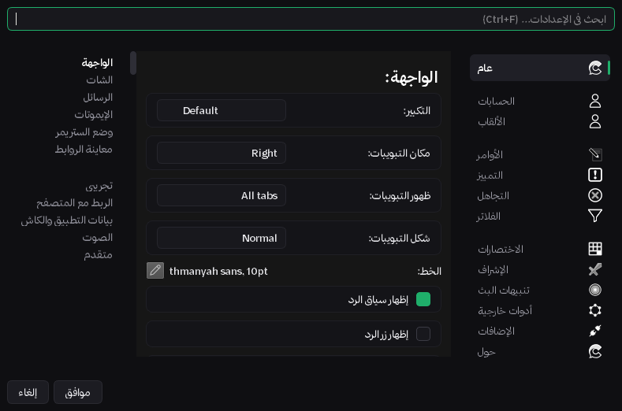

<div dir="rtl">

<p align="center"></p>

# Chatterino AR (شاترينو العربي)

نسخة عربية من [Chatterino](https://github.com/Chatterino/chatterino2) لشات تويتش، مبنية على الإصدار 2.5.6.

**Made By RayanAthlawi**



## التحميل

حمّل آخر نسخة من صفحة [الإصدارات (Releases)](../../releases/latest)، فك الضغط، وشغّل `chatterino.exe`. (ويندوز 10 و 11، 64 بت)

## المميزات

- واجهة معرّبة بالكامل، واتجاه من اليمين لليسار
- الرسائل العربية تبدأ من اليمين بترتيب صحيح، والإنجليزية من اليسار
- تصميم داكن بسيط بلون مميز أخضر، وخط ثمانية واضح
- صور المستخدمين جنب أسمائهم في الشات
- مشغّل بث صغير فوق الشات (480p أو أقل، يبدأ بدون صوت)
- خيار «احسبني مشاهد في البث»: يحسبك مشاهد واحد في القنوات الظاهرة قدامك، بالخلفية وبدون ما ياكل رامات
- الإعدادات تفتح داخل نفس النافذة، وشاشة تحميل وشعار خاص

## البناء من الكود

ملفات خط ثمانية **مو موجودة في هذا المستودع**، لأن [رخصة الخط](https://thmanyah.com) تمنع إعادة نشر ملفاته. نزّل الخط من موقع ثمانية الرسمي وحط ملفات `thmanyahsans-*.otf` في `resources/fonts/`. بدونها، البرنامج يشتغل بخط النظام.

بعدها اتبع [BUILDING_ON_WINDOWS.md](BUILDING_ON_WINDOWS.md)، أو شغّل `build-ar.bat` (يحتاج Visual Studio 2022 و Qt 6.8.3 مع Qt Multimedia و Conan).

## الرخص

- الكود تحت رخصة MIT نفسها حق Chatterino (شوف [LICENSE](LICENSE)).
- خط ثمانية ملك لشركة ثمانية للنشر والتوزيع، ويُستخدم داخل البرنامج المبني حسب رخصتها.
- مشغّل البث يستخدم Qt Multimedia و FFmpeg (رخصة LGPL).

</div>

---


Chatterino 2 [](https://github.com/Chatterino/chatterino2/actions?query=workflow%3ABuild+branch%3Amaster) [](https://cirrus-ci.com/github/Chatterino/chatterino2/master) [](https://chocolatey.org/packages/chatterino) [](https://flathub.org/apps/details/com.chatterino.chatterino)
============

Chatterino 2 is a chat client for [Twitch.tv](https://twitch.tv).
The Chatterino 2 wiki can be found [here](https://wiki.chatterino.com).
Contribution guidelines can be found [here](https://wiki.chatterino.com/Contributing%20for%20Developers).

## Download

Current releases are available at [https://chatterino.com](https://chatterino.com).
Windows users can also install Chatterino [from Chocolatey](https://chocolatey.org/packages/chatterino).

## Nightly build

You can download the latest Chatterino 2 build over [here](https://github.com/Chatterino/chatterino2/releases/tag/nightly-build)

You might also need to install the [VC++ Redistributables](https://aka.ms/vs/17/release/vc_redist.x64.exe) from Microsoft if you do not have it installed already.  
If you still receive an error about `MSVCR120.dll missing`, then you should install the [VC++ 2013 Restributable](https://download.microsoft.com/download/2/E/6/2E61CFA4-993B-4DD4-91DA-3737CD5CD6E3/vcredist_x64.exe).

## Building

To get source code with required submodules run:

```shell
git clone --recurse-submodules https://github.com/Chatterino/chatterino2.git
```

or

```shell
git clone https://github.com/Chatterino/chatterino2.git
cd chatterino2
git submodule update --init --recursive
```

- [Building on Windows](../master/BUILDING_ON_WINDOWS.md)
- [Building on Windows with vcpkg](../master/BUILDING_ON_WINDOWS_WITH_VCPKG.md)
- [Building on Linux](../master/BUILDING_ON_LINUX.md)
- [Building on macOS](../master/BUILDING_ON_MAC.md)
- [Building on FreeBSD](../master/BUILDING_ON_FREEBSD.md)

## Git blame

This project has big commits in the history which touch most files while only doing stylistic changes. To improve the output of git-blame, consider setting:

```shell
git config blame.ignoreRevsFile .git-blame-ignore-revs
```

This will ignore all revisions mentioned in the [`.git-blame-ignore-revs`
file](./.git-blame-ignore-revs). GitHub does this by default.

## Code style

The code is formatted using [clang-format](https://clang.llvm.org/docs/ClangFormat.html). Our configuration is found in the [.clang-format](.clang-format) file in the repository root directory.

For more contribution guidelines, take a look at [the wiki](https://wiki.chatterino.com/Contributing%20for%20Developers/).

## Doxygen

Doxygen is used to generate project information daily and is available [here](https://doxygen.chatterino.com).
